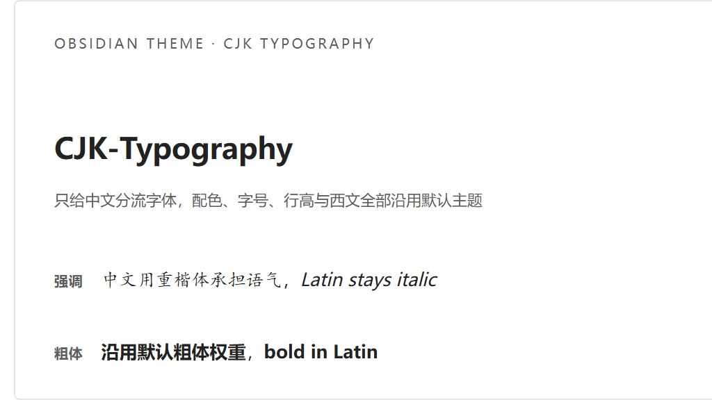

# CJK-Typography

一个只改中文排版、不碰配色与布局的 Obsidian 主题。

它以 **Obsidian 原生默认主题（app.css）为基准**：颜色、字体栈、字号、行高、间距、明暗模式全部沿用默认声明，本主题只做一件事——把中文分流到更合适的字体。

仓库同时提供等价的 **CSS 片段** `cjk-typography.css`：不想安装主题（或想继续用别的主题）就退回单文件方案，见「安装 → 方式二」。



## 效果

| Markdown | 渲染结果 | 与默认主题的差别 |
|---|---|---|
| `*文字*` | 中文重楷体 | 只换 `font-family`；字重 400、italic、颜色仍是默认值 |
| `**文字**` | 默认粗体 | 无视觉差别（主题不声明 `font-weight`；片段显式写 `var(--bold-weight)`，取值与默认相同） |
| `***文字***` | 默认粗体 + 斜体 | 只换 `font-family`；不加着重号 |
| `` `代码` `` / 代码块 | 中文等宽字体 | 只换 `font-family`；字号仍取默认的 `--code-size` |
| 代码里的 `**` `*` | 归一为常规 | 主动中和：等宽网格里不加斜体/加粗 |

西文完全走默认字体栈（`var(--font-text)` / `var(--font-monospace)`），两份文件里都没有出现任何西文字体名。中文靠 `unicode-range`（`U+2E80-9FFF`、`U+F900-FAFF`、`U+FE30-FE4F`、`U+FF00-FFEF`）命中，未命中的字符自然回退。

## 为什么粗体一栏是「无差别」

Obsidian 的默认粗体规则在版本之间变过：

| 版本 | 默认 `strong` 声明 |
|---|---|
| 1.13.7 | `font-weight: calc(var(--font-weight) + var(--bold-modifier))` |
| 1.5.8 | `font-weight: var(--bold-weight)`，且**没有** `--bold-modifier` / `--font-weight` |

如果照抄某个版本的算式，在缺少那两个变量的版本里 `calc()` 会变成「无效的计算值」，`font-weight` 退回继承的 400 —— 全库粗体静默消失。所以主题**完全不声明 `font-weight`**，把这一层完整交给默认主题；片段则显式写了两版都存在的 `var(--bold-weight)`，取值与默认一致。两份文件都不会踩这个坑。

## 安装

两种方式任选其一，效果一致：都是「默认主题 + 中文分流字体」。

### 方式一：安装主题（推荐）

1. 把整个 `CJK-Typography` 文件夹放进库中：

   ```
   <你的库>/.obsidian/themes/CJK-Typography/
   ├── manifest.json
   └── theme.css
   ```

   文件夹名必须与 `manifest.json` 里的 `name` 完全一致，否则 Obsidian 会静默忽略。

2. **重启 Obsidian**（manifest 的改动需要重启才会被读取）。
3. 设置 → 外观 → 主题，选择 **CJK-Typography**。

之后改 `theme.css` 会热重载，不必再重启。`README.md`、`preview*`、`tools/` 只是仓库里的开发文件，不会被 Obsidian 读取。

### 方式二：只用 CSS 片段（不想装主题时）

不想让主题替换掉当前主题，或者想继续用别的主题，就退回这个方案——单文件、不碰主题列表：

1. 把 `cjk-typography.css` 复制到库的片段目录（没有该目录就新建）：

   ```
   <你的库>/.obsidian/snippets/cjk-typography.css
   ```

2. 设置 → 外观 → **CSS 代码片段** → 点「刷新」→ 打开 `cjk-typography` 的开关。
3. 主题保留默认（或其他任意主题）即可，片段会叠加在上面。

片段与主题共用同一套 `@font-face` 和 `unicode-range`，中文分流规则完全相同。差别只在几处细节：

| | 片段 `cjk-typography.css` | 主题 `theme.css` |
|---|---|---|
| 安装位置 | `.obsidian/snippets/` | `.obsidian/themes/CJK-Typography/` |
| 启用方式 | 外观 → CSS 代码片段 → 开关 | 外观 → 主题 → 下拉选择 |
| 与当前主题的关系 | 叠加，可继续用第三方主题 | 替代默认主题，本身成为当前主题 |
| 改完生效 | 点「重新加载片段」 | 自动热重载 |
| 代码块细节 | 额外关掉连字、`tab-size: 4`、显式 `font-size` | 全部留给默认主题 |
| 分发 | 单文件，复制即用 | 整个文件夹，可提交社区主题库 |

两者都不依赖任何一版独有的字重变量：主题干脆不声明，片段写 `var(--bold-weight)`，最终结果都等于默认的 600。

## 字体依赖

主题与片段都只写 `local()` 引用，不打包字体：装了就用，没装就往下回退，仓库体积不变。

**强调（`CJK-Em`）**：LXGW WenKai Screen / 霞鹜文楷屏幕阅读版 → LXGW ZhenKai / 霞鹜臻楷 → KaiTi / 楷体 → STKaiti → Kaiti SC

**代码（`CJK-Code`）**：Sarasa Mono SC → Noto Sans Mono CJK SC → Maple Mono NF CN → Microsoft YaHei Mono → SimHei

换字体只需调整 `@font-face` 里 `local()` 的顺序。`local()` 用的是字体在系统中的**真实名称**，各平台命名不一（macOS 常见 `Kaiti SC`，Windows 常见 `楷体`），所以两套都列上。

## 验证方式

仓库里的 `preview.html` 直接加载 Obsidian 的真实 `app.css`，再叠加 `theme.css`，页面顶部可切换「叠加主题 / 深色」。基准文件需要从本机安装中提取：

```bash
node tools/extract-default-css.mjs            # 自动探测安装位置
node tools/extract-default-css.mjs --asar <路径> --out <输出.css>
```

脚本会优先选版本号最高的 asar（Obsidian 的自更新会先把新版 asar 暂存在 `%APPDATA%\obsidian\`，重启后才替换安装目录）。

`preview-default-theme.css` 是 Obsidian 的版权文件，已列入 `.gitignore`，不随仓库分发。

实测结果（1.13.7 的 app.css）：

- `em` → `font-family: CJK-Em, …`，`font-style` 仍是默认的 italic
- `strong` → `font-weight: 600`，字体与默认完全一致
- `em strong` → 600 + italic，字体走 `CJK-Em`
- 行内代码 / 代码块 → `font-family: CJK-Code, …`，字号 14px（= 默认 `--code-size`）
- 代码内的 `em` / `strong` → 被中和成 400 / normal
- 深色模式 → 仅 `--text-normal` 等颜色变量变化，主题不参与

`preview.png`（浅色 + 主题）、`preview-baseline.png`（浅色 + 纯默认）、`preview-dark.png`（深色 + 主题）是同一次渲染的截图。

片段 `cjk-typography.css` 用同样的方法单独跑过一遍，结果与主题一致：`em` → `CJK-Em`、`strong` → 600 + 默认字体栈、`em strong` → 600 + italic + `CJK-Em`、代码 → `CJK-Code`（14px）、代码内的 `em`/`strong` → 400 / normal，`document.fonts` 中两个 `@font-face` 均已注册。

## 已知限制

- `text-autospace` 属于 CSS Text 4 草案，仅较新的 Chromium 支持；不支持时整条声明被忽略，中西文之间不会自动加间距，其余不受影响。
- 编辑模式样式依赖 CodeMirror 6 的类名（`.cm-em`、`.cm-strong`、`.cm-inline-code`、`.HyperMD-codeblock`）。Obsidian 大版本若重命名这些类，需要同步调整。
- 行内代码 `font-size` 不再由主题声明，完全跟随默认的 `--code-size`；若某个子主题改了这个变量，代码字号会跟着变。片段版仍显式声明了 `font-size: var(--font-smaller)`，两者当前取值相同。

## 缩略图

`screenshot.png` 是 1024×576（512×288 的 2× 版本，16:9），可直接用作社区主题库的缩略图。它由脚本生成，卡片内容只保留强调 / 粗体 / 行内代码三行，缩到 512 宽仍能看清：

```bash
node tools/extract-default-css.mjs   # 先有官方 app.css 作底
node tools/make-screenshot.mjs       # 输出 screenshot.png
```

需要改文案或配色，直接改脚本里的卡片 HTML；换浏览器可用 `EDGE_PATH` / `CHROME_PATH` 指定可执行文件。

## 提交到社区主题库还需补的东西

- ~~16:9 缩略图~~ —— 已有 `screenshot.png`，重跑 `tools/make-screenshot.mjs` 可再生成
- ~~`LICENSE`~~ —— 已采用 MIT
- `manifest.json` 里的 `author` 换成你自己的名字或 ID
- 按主题审核规范再核对一遍 `README.md`

## 许可

[MIT](LICENSE) © 2026 BallBall11

例外：`preview-default-theme.css` 是从本机 Obsidian 安装中提取的 `app.css`，版权归 Obsidian 所有，仅限本地预览对照使用，不随仓库分发（已列入 `.gitignore`）。
